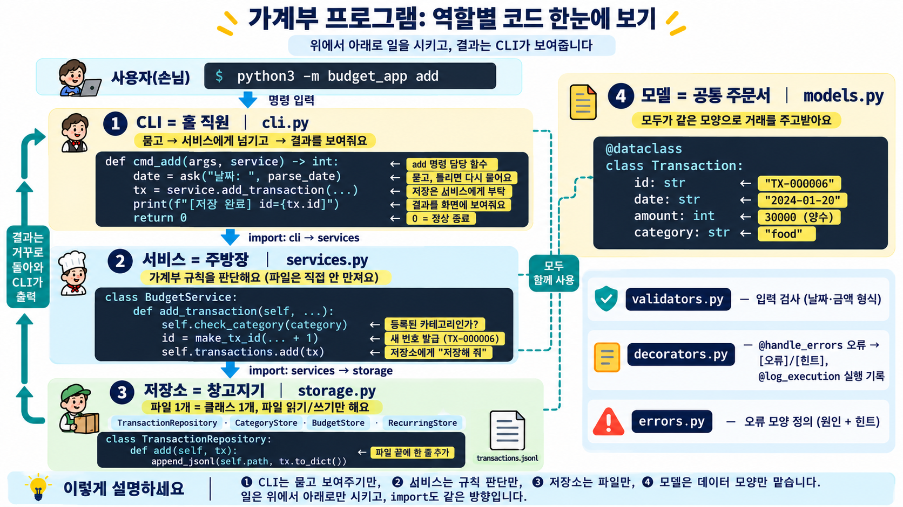
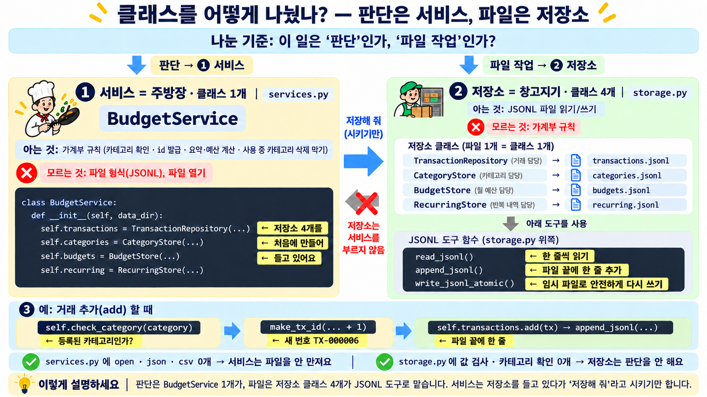
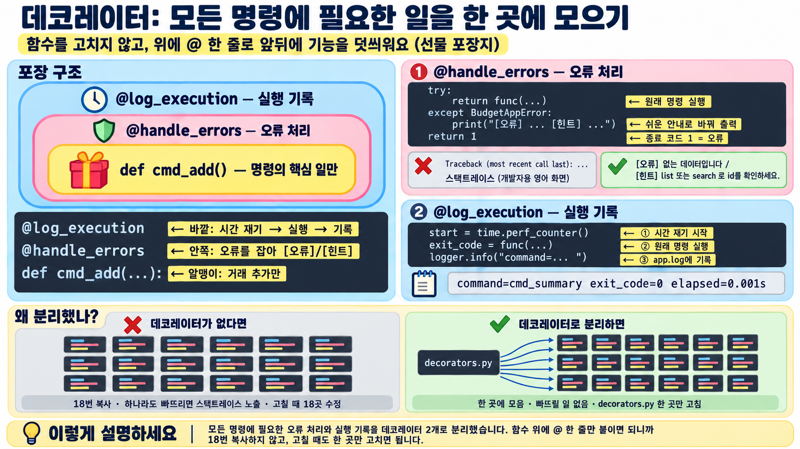
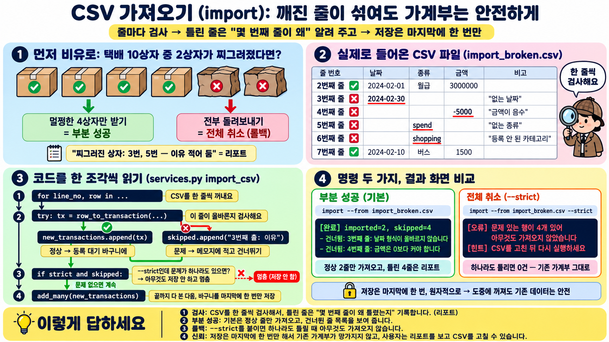

# PASS 노트 — 평가 항목별 답변 · 시연 · 보여줄 코드

> 항목마다 **약 3분**. 형식은 모두 같아요.
> **한 줄 답** → 🗣 **말하기** → 👀 **보여줄 코드** → 🖥 **시연**
> 코드 링크를 누르면 해당 줄로 바로 이동해요.

## 시연 전 준비 (1분)

1. VS Code를 위아래로 나눠서 쓸 수 있게 열어 둡니다. 위쪽은 코드, 아래쪽은 터미널이에요. 글자 크기는 `Cmd + =`로 키워요.
2. 탭을 순서대로 열어 둡니다: `cli.py` → `services.py` → `storage.py` → `decorators.py` → `models.py`
3. 터미널에서 처음 상태로 만듭니다.
   ```bash
   rm -rf data export.csv
   python3 -m unittest        # "Ran 99 tests ... OK" → 시작할 때 자신감 있게 한 번
   ```

## 🗂 전체 질문 한눈에 보기 (누르면 바로 이동)

**[항목 1](#item1)**
- ❓ [add/list/search/summary/export/import/update/delete가 요구사항대로 동작하는가?](#item1)
- ❓ [프로그램 재실행 후에도 거래/카테고리/예산 데이터가 유지되는가? (저장 파일 3개 이상)](#item1)
- ❓ [category add/list/remove가 정상 동작하는가? (삭제 시 사용 중인 카테고리 처리 포함)](#item1)
- ❓ [budget set이 저장되며, summary에서 예산 사용률/초과 여부가 출력되는가?](#item1)
- ❓ [import/export가 명시된 CSV 스키마(UTF-8, 헤더, 컬럼)로 동작하는가?](#item1)
- ❓ [잘못된 입력/파일 오류에서 스택트레이스 없이 오류 메시지와 해결 힌트를 출력하는가?](#item1)
- ❓ [오류 상황에서 종료 코드가 0이 아님을 확인할 수 있는가?](#item1)

**[항목 2](#item2)**
- ❓ [Q1. 코드가 3개 이상 모듈로 분리되어 있고, 각 모듈의 책임을 “어떻게” 나눴는지 설명할 수 있는가?](#i2q1)
- ❓ [Q2. 최소 2개 이상의 클래스에 부여한 책임 경계를 “어떻게” 정했는지 설명할 수 있는가?](#i2q2)
- ❓ [Q3. 파일 기반 update/delete를 “어떻게” 안전하게 처리했는지 설명할 수 있는가?](#i2q3)

**[항목 3](#item3)**
- ❓ [Q1. list/search를 제너레이터로 스트리밍 처리한 방식을 “어떻게” 구현했고, “왜” 유리한지 설명할 수 있는가?](#i3q1)
- ❓ [Q2. 데코레이터로 분리한 공통 기능이 무엇이며, “왜” 분리가 필요했는지 설명할 수 있는가?](#i3q2)
- ❓ [Q3. 타입 힌트를 적용해 얻는 이점을 실제 코드 예로 “어떻게” 확인했고 “왜” 도움이 되는지 설명할 수 있는가?](#i3q3)

**[항목 4](#item4)**
- ❓ [Q1. JSONL과 CSV 중 선택한 저장 포맷의 장단점을 비교하고, “왜” 그 포맷을 택했는지 근거를 말할 수 있는가?](#i4q1)
- ❓ [Q2. 거래가 10만 건으로 늘어난다면, 현재 구조에서 병목이 어디이며 “어떻게” 개선할지 설명할 수 있는가?](#i4q2)
- ❓ [Q3. import CSV에 일부 깨진 행이 섞이면, “어떻게” 처리해 사용자 신뢰를 지킬지(부분 성공/롤백/리포트) 설명할 수 있는가?](#i4q3)

**[항목 5](#item5)**
- ❓ [보너스 문제 해결에 따른 크레딧 부여](#item5)

**[꼬리 질문 대비](#tail)**

---

<a id="item1"></a>

## <span style="color:#FFFFFF;background:#1D4ED8;font-size:1.5em;padding:4px 14px;border-radius:8px">항목 1 — 3분</span>

| # | 명령 | 화면에서 짚을 것 | 증명하는 체크 |
| --- | --- | --- | --- |
| 1 | `python3 -m budget_app category list` | `[안내]` 기본 카테고리 자동 생성 | category list, 초기 실행 |
| 2 | `python3 -m budget_app budget set --month 2024-01 --amount 500000` | `[저장 완료]` | budget set |
| 3 | `python3 -m budget_app import --from samples/import_ok.csv` | `imported=5` | import |
| 4 | `python3 -m budget_app add` (날짜에 `2024-13-40` → 다시 `2024-01-20`, expense, food, 30000, 친구 저녁, meal,friend) | `[오류]`/`[힌트]` 후 다시 물음 → `id=TX-000006` | add, 오류 + 힌트 |
| 5 | `python3 -m budget_app list --limit 3` | 최신순 | list |
| 6 | `python3 -m budget_app search --from 2024-01-01 --to 2024-01-31 --category food` | 식비 3건 | search |
| 7 | `python3 -m budget_app summary --month 2024-01 --top 3` | **사용률 111.7% + `[경고]`** | summary, 예산 |
| 8 | `python3 -m budget_app update --id TX-000006 --amount 25000` | `[수정 완료]` | update |
| 9 | `python3 -m budget_app delete --id TX-000006` | `[삭제 완료]` | delete |
| 10 | 같은 명령 한 번 더 → `echo $?` | `없는 데이터` + **`1`** | 오류 종료 코드 |
| 11 | `python3 -m budget_app category remove --name food` | 사용 중이라 삭제 막힘 | category remove |
| 12 | `python3 -m budget_app export --out export.csv --month 2024-01` → `head -2 export.csv` | 헤더 `date,type,category,amount,memo,tags` | export, CSV 스키마 |
| 13 | `python3 -m budget_app summary --month 2024-13` → `echo $?` | Traceback 없이 원인 + 힌트, **`1`** | 스택트레이스 없음 |
| 14 | `ls data` | `transactions` / `categories` / `budgets` … | 저장 파일 3개 이상, 재실행 후 유지 |

🗣 **마무리 한마디**: "명령 하나하나가 프로그램을 새로 실행하는 거라서, 앞에서 넣은 데이터가 계속 보인다는 것 자체가 **재실행 후에도 유지된다**는 증거입니다."

### ⏱ 코드 30초 설명 — 명령 하나 = 함수 하나

🖥 **명령**: `python3 -m budget_app add`

👀 **핵심 코드**: [cli.py:56-69](../budget_app/cli.py#L56-L69) `cmd_add`
```python
@log_execution                          # [@ = 기능 덧씌우기] 로그·걸린 시간 기록
@handle_errors                          # [@] 오류 → [오류]/[힌트]로 바꿔 출력
def cmd_add(args, service) -> int:      # [def = 함수 만들기, -> int = 숫자를 돌려줌] 명령 함수
    tx = service.add_transaction(       # 서비스에게 "저장해 줘"
        date=ask("날짜: ", parse_date), #   묻고 → 검사 → 틀리면 다시 묻기
        ...
    )
    print(f"[저장 완료] id={tx.id}")     # [f"{값}" = 글자 안에 값 끼워 넣기] → id=TX-000006
    return 0                            # [return = 돌려주기] 0 = 정상 종료 (오류면 1)
```

🎯 **핵심**: "모든 명령이 **입력 → 서비스 호출 → 출력 → `return`** 같은 모양입니다."

---

<a id="item2"></a>

## <span style="color:#FFFFFF;background:#1D4ED8;font-size:1.5em;padding:4px 14px;border-radius:8px">항목 2 — 3분</span>

<a id="i2q1"></a>

### ❓ <span style="color:#B91C1C;background:#FEF3C7;font-size:1.6em;font-weight:800;padding:4px 10px;border-radius:6px;line-height:1.6">Q1. 코드가 3개 이상 모듈로 분리되어 있고, 각 모듈의 책임을 “어떻게” 나눴는지 설명할 수 있는가?</span>

🎯 **질문 의도**: 파일을 3개 이상으로 **쪼갰는지**를 보는 질문이 아닙니다. 각 모듈이 **무엇을 맡고 무엇을 안 맡는지** 스스로 설명할 수 있는지, 그리고 그 경계가 **코드에서 실제로 지켜지는지**를 봅니다.
(과제 목표: "각 계층(모델/저장소/서비스/CLI)의 책임을 설명할 수 있다")

**한 줄 답**: CLI · 서비스 · 저장소 · 모델 **4개**로 나눴습니다.

| 계층 | 책임 (맡는 일) |
| --- | --- |
| ① CLI | 사람과 대화 (명령 해석, 입력 받기, 화면 출력) |
| ② 서비스 | 규칙 판단 (카테고리 확인, id 발급, 요약 계산) |
| ③ 저장소 | 파일 다루기 (읽기/쓰기, 안전한 교체) |
| ④ 모델 | 데이터 모양 (거래 1건의 칸과 타입) |
| **방향** | 일은 **위 → 아래로만** 시킴. import도 같은 방향 (cli → services → storage → models) |



> 💡 **왜 이렇게?** "**고칠 일이 생겼을 때 그 파일만 고치면 되도록** 역할별로 나눴습니다. 그래서 **다른 곳을 잘못 건드릴 일이 줄고**, **부분별로 따로 테스트**할 수 있습니다."

```
  사람 (터미널)
     │  python3 -m budget_app add
     ▼
┌─────────────────────────────────────────────────────────────┐
│ ① CLI      cli.py · prompts.py · formatter.py               │  홀 직원 : 주문 받고 음식 내주기 (명령 해석, 입력 받기, 화면 출력)
├─────────────────────────────────────────────────────────────┤
│ ② 서비스   services.py                                       │  주방장  : 규칙(레시피)대로 처리
├─────────────────────────────────────────────────────────────┤
│ ③ 저장소   storage.py                                        │  창고지기: 파일 넣고 꺼내기
└─────────────────────────────────────────────────────────────┘
        ④ 모델 models.py = 모두가 같이 쓰는 "주문서 양식"(데이터 모양)
   + 공통 도구: validators.py(입력 검사) · decorators.py(오류·로그) · errors.py(오류 모양)
```

**왜 4개로 나눴나?** — 기준은 **"바뀌는 이유가 다르면 다른 파일에 둔다"** 입니다. 가계부 프로그램이 바뀌는 이유는 크게 4가지라서 4개 계층이 되었습니다.

| 계층 | 맡은 일 | 이 계층이 바뀌는 때 | 한 파일에 섞여 있었다면 | 코드 |
| --- | --- | --- | --- | --- |
| ① CLI (`cli.py` 등) | 명령 해석, 입력 받기, 화면 출력 | 화면 문구·표 모양·옵션 이름을 바꿀 때 | 문구 하나 고치다가 계산 규칙을 건드릴 수 있음 | [하는 일/안 하는 일](../budget_app/cli.py#L1-L15) · [cmd_add](../budget_app/cli.py#L59-L72) |
| ② 서비스 (`services.py`) | 가계부 규칙: 카테고리 확인, id 발급, 요약·예산 계산 | 규칙이 바뀔 때 (예: 사용 중 카테고리 삭제 정책) | 규칙을 테스트하려면 매번 사람이 입력해야 함 | [하는 일/안 하는 일](../budget_app/services.py#L1-L9) · [add_transaction](../budget_app/services.py#L115) |
| ③ 저장소 (`storage.py`) | 파일 읽기/쓰기, 원자적 저장 | 저장 방식을 바꿀 때 (JSONL → CSV, sqlite3) | 저장 형식을 바꾸면 프로그램 전체를 고쳐야 함 | [하는 일/안 하는 일](../budget_app/storage.py#L1-L13) · [write_jsonl_atomic](../budget_app/storage.py#L67) |
| ④ 모델 (`models.py`) | 데이터 모양 (필드·타입) | 거래에 새 필드를 추가할 때 | 같은 데이터 모양을 여러 곳에 중복으로 정의하게 됨 | [하는 일/안 하는 일](../budget_app/models.py#L1-L7) · [Transaction](../budget_app/models.py#L26-L35) |

> 미션 권장 구성(CLI / 서비스 / 저장소 / 모델)과도 같습니다. 3개(필수 최소)가 아니라 4개로 나눈 이유는, 모델을 따로 두어야 **모든 계층이 같은 데이터 모양(`Transaction`)을 함께 쓸 수 있기** 때문입니다.

🗣 **말하기**
1. **책임** — "CLI는 사람과 대화(입력·출력)만, 서비스는 가계부 규칙(카테고리 확인, id 발급, 요약 계산)만, 저장소는 파일 읽기/쓰기만, 모델은 데이터 모양만 정합니다. 모든 파일 맨 위에 **'하는 일 / 안 하는 일'**을 적어서 경계를 글로 정했습니다."
2. **경계가 지켜진다는 증거** — "import 방향이 한쪽입니다. `cli`는 `services`를, `services`는 `storage`를, `storage`는 `models`를 가져다 쓰고, **거꾸로 가져다 쓰는 곳은 없습니다.** 화면 출력(`print`)도 CLI 쪽 파일과 오류를 찍는 `decorators.py`에만 있고, **서비스 · 저장소 · 모델에는 하나도 없습니다.**"
3. **나눠서 얻는 것** — "저장 형식을 바꾸려면 `storage.py`만, 화면 모양을 바꾸려면 `formatter.py`만 고치면 됩니다. 서비스는 `input`/`print`가 없어서 사람이 입력하지 않아도 테스트로 바로 검사할 수 있습니다."

👀 **보여줄 코드**
- 파일 맨 위 '하는 일 / 안 하는 일': [cli.py:1-15](../budget_app/cli.py#L1-L15), [services.py:1-9](../budget_app/services.py#L1-L9), [storage.py:1-13](../budget_app/storage.py#L1-L13), [models.py:1-7](../budget_app/models.py#L1-L7)
- 한 방향 import: [cli.py:23-36](../budget_app/cli.py#L23-L36) → [services.py:17-42](../budget_app/services.py#L17-L42) → [storage.py:24-25](../budget_app/storage.py#L24-L25)

<a id="i2q2"></a>

### ❓ <span style="color:#B91C1C;background:#FEF3C7;font-size:1.6em;font-weight:800;padding:4px 10px;border-radius:6px;line-height:1.6">Q2. 최소 2개 이상의 클래스에 부여한 책임 경계를 “어떻게” 정했는지 설명할 수 있는가?</span>

🎯 **질문 의도**: 클래스를 2개 이상 **만들었는지**를 보는 질문이 아닙니다. 클래스마다 **무엇을 알고 무엇을 모르는지(책임 경계)** 를 정한 **기준**이 있는지, 그 기준을 내 말로 설명할 수 있는지를 봅니다. 핵심 단어는 **"어떻게"** 입니다.

**한 줄 답**: "**서비스 클래스 1개**(`BudgetService`)와 **저장소 클래스 4개**(거래·카테고리·예산·반복 내역)로 나눴습니다. 기준은 **규칙 판단은 서비스, 파일 읽기/쓰기는 저장소**입니다. 저장소는 **파일 1개당 클래스 1개**로 맡고, 서비스는 파일을 직접 열지 않고 저장소에게 **시키기만** 합니다."



🗣 **그림을 짚으며 말하기 (약 40초)**
1. **기준** (맨 위 띠) — "클래스는 **'판단하는 일인가, 파일 작업인가'** 를 기준으로 나눴습니다."
2. **서비스** (왼쪽 카드) — "판단은 **`BudgetService` 1개**가 맡습니다. 카테고리 확인, id 발급, 예산 계산 같은 규칙만 알고, 파일은 열지 않습니다."
3. **저장소** (오른쪽 카드) — "파일 작업은 **저장소 클래스 4개**가 맡습니다. 파일 1개당 클래스 1개이고, JSONL 도구 함수로 읽고 씁니다. 규칙은 판단하지 않습니다."
4. **연결** (가운데 화살표, 왼쪽 코드) — "서비스는 `__init__`에서 저장소 4개를 만들어 **들고 있다가**, '저장해 줘'라고 **시키기만** 합니다. 저장소는 서비스를 부르지 않습니다."
5. **예시** (③ add 띠) — "거래를 추가하면, 서비스가 카테고리를 확인하고 번호를 발급한 뒤, 저장소가 파일 끝에 한 줄을 씁니다."
6. **증거** (초록 체크 띠) — "실제로 `services.py`에는 파일 도구가 0개, `storage.py`에는 규칙 검사가 0개입니다."

> 🎯 **핵심 한 문장**: "**판단은 서비스 1개, 파일 작업은 저장소 4개**로 나눴고, 서비스는 저장소에게 시키기만 합니다."

| 답의 구조 | 클래스 | 맡은 일 | 안 하는 일 (경계) | 증거 |
| --- | --- | --- | --- | --- |
| ① 서비스 1개 | [`BudgetService`](../budget_app/services.py#L52) | **규칙 판단**: [카테고리 확인](../budget_app/services.py#L104), [id 발급](../budget_app/services.py#L127), [요약·예산 계산](../budget_app/services.py#L178), [사용 중 카테고리 삭제 막기](../budget_app/services.py#L83) | 파일 열기 | [`services.py` import 목록](../budget_app/services.py#L11-L42)에 `open` · `json` · `csv` **0개** |
| ② 저장소 4개<br>(파일 1개 = 클래스 1개) | [`TransactionRepository`](../budget_app/storage.py#L89) → `transactions.jsonl`<br>[`CategoryStore`](../budget_app/storage.py#L136) → `categories.jsonl`<br>[`BudgetStore`](../budget_app/storage.py#L153) → `budgets.jsonl`<br>[`RecurringStore`](../budget_app/storage.py#L175) → `recurring.jsonl` | **파일 읽기/쓰기** ([JSONL 도구 함수](../budget_app/storage.py#L38-L84)) | 규칙 판단 | [`storage.py` import 목록](../budget_app/storage.py#L15-L25)에 `validators` 없음 → 값 검사 · 카테고리 확인 **0개** |
| ③ 연결 방식 | 서비스가 저장소 4개를 **들고 있음** | 서비스 → 저장소에게 "[저장해 줘](../budget_app/services.py#L135)" | 저장소 → 서비스 호출 ✕ | [services.py:55-61](../budget_app/services.py#L55-L61) |

> 📚 **비유**: 주방장(서비스) 1명 + 창고 담당(저장소) 4명. 주방장은 창고 문을 직접 열지 않고 "계란 갖다줘"라고 시키기만 하고, 창고 담당은 "이 요리에 계란이 맞나?"를 판단하지 않습니다.

**왜 클래스를 쓰나?**
- **묶기**: 관련 있는 데이터와 기능을 한 덩어리로 모읍니다. 예를 들어 `BudgetStore`는 예산 파일 경로와 읽기/쓰기 기능을 함께 가지고 있습니다.
- **이름 붙이기**: 클래스 이름만 봐도 담당이 보입니다. `BudgetStore`는 예산 저장, `BudgetService`는 규칙 담당입니다.
- **맡기기**: 서비스는 파일을 직접 만지지 않고 "저장해 줘"라고 저장소 객체에게 시키기만 합니다. 그래서 저장 방식이 바뀌어도 서비스는 그대로입니다.

| 클래스 (= 데이터와 기능을 한데 묶은 틀) | 아는 것 | 모르는 것 |
| --- | --- | --- |
| `Transaction` (모델) | 거래 1건의 모양 (id, 날짜, 금액…) | 파일, 규칙 |
| `TransactionRepository`, `CategoryStore`, `BudgetStore` (저장소) | **파일 1개 = 클래스 1개**, 읽기/쓰기 방법 | "카테고리가 등록됐나?" 같은 규칙 |
| `BudgetService` (서비스) | 규칙: 카테고리 확인, id 발급, 삭제 막기 | 파일이 JSONL인지 CSV인지 |

🗣 **말하기**: "경계가 맞는지는 이 질문으로 확인했습니다. **'저장 형식을 JSONL에서 다른 걸로 바꾸면 어디를 고치나?'** → `storage.py`만 고치면 됩니다. 서비스는 저장소 클래스에게 시키기만 하기 때문입니다."

👀 **보여줄 코드**: 서비스가 저장소들을 들고 일을 시키는 부분 — [services.py:55-62](../budget_app/services.py#L55-L62)

<a id="i2q3"></a>

### ❓ <span style="color:#B91C1C;background:#FEF3C7;font-size:1.6em;font-weight:800;padding:4px 10px;border-radius:6px;line-height:1.6">Q3. 파일 기반 update/delete를 “어떻게” 안전하게 처리했는지 설명할 수 있는가?</span>

**한 줄 답**: "**임시 파일에 다 쓴 뒤 한 번에 바꿔치기**합니다. (원자적 저장: 전부 되거나 아예 안 되거나 — 실패해도 원본은 그대로)"

```
 transactions.jsonl (원본)
        │  한 줄씩 읽으면서, 바꿀 줄만 바꿔서
        ▼
 transactions.jsonl.tmp (임시 파일)에 전부 쓰기
        │  끝까지 성공했을 때만
        ▼
 os.replace()  →  원본과 '한 번에' 교체  ✅

 ✗ 쓰는 도중 실패하면?  →  임시 파일만 지우고, 원본은 그대로
```

🗣 **말하기**: "원본을 직접 고치다가 프로그램이 꺼지면 파일이 반쯤 망가집니다. 그래서 새 파일을 따로 완성한 다음, 마지막에 이름만 한 번에 바꿉니다. 실패하면 원본이 그대로 남습니다."

👀 **보여줄 코드**: [storage.py:67-84](../budget_app/storage.py#L67-L84) `write_jsonl_atomic` (81번 줄 `os.replace`), 이 함수를 쓰는 [update](../budget_app/storage.py#L123-L128) · [delete](../budget_app/storage.py#L130-L133)

📖 **update 코드 읽는 법** — 공책을 새로 베껴 쓰기
```python
records = (
    new_tx.to_dict() if tx.id == new_tx.id else tx.to_dict()   # 고칠 id면 새 내용, 아니면 그대로
    for tx in self.iter_all()                                  # 파일의 거래를 한 건씩 꺼내서
)
write_jsonl_atomic(self.path, records)                         # 다 베낀 뒤 한 번에 교체
```
- 고칠 줄만 새로 쓰고, 나머지는 그대로 베껴서 새 파일을 만든 뒤 바꿔치기합니다. (delete는 지울 id만 **빼고** 베낌)
- `to_dict()` = 거래를 파일에 쓸 수 있는 **dict(딕셔너리: 이름표 : 값 묶음)** 모양으로 바꿈. 예: `{"id": "TX-000002", "amount": 20000}`

🖥 **시연 (증거)**: "중간에 실패해도 원본이 그대로인지" 테스트로 보여주기
```bash
python3 -m unittest tests.test_storage.AtomicWriteTest -v
```
→ `test_failure_in_the_middle_keeps_original_file ... ok`

### ⏱ 코드 30초 설명 — 저장소에게 맡기고, 임시 파일로 안전하게

🖥 **명령**: `python3 -m budget_app update --id TX-000006 --amount 25000`

👀 **핵심 코드**: [services.py:55-58](../budget_app/services.py#L55-L58) `BudgetService` → [storage.py:67-83](../budget_app/storage.py#L67-L83) `write_jsonl_atomic`
```python
class BudgetService:                              # [class = 틀 만들기] 규칙 담당
    def __init__(self, data_dir) -> None:         # [__init__ = 처음 만들 때 실행]
        self.transactions = TransactionRepository(...)  # [self.x = 내가 가진 x] 거래 파일 담당을 들고 있음

def write_jsonl_atomic(path, records) -> None:    # (storage.py) update/delete가 부르는 함수
    tmp_path = path.with_name(path.name + ".tmp") #   임시 파일 이름: transactions.jsonl.tmp
    try:                                          # [try = 일단 해 보기]
        ...                                       #   임시 파일에 한 줄씩 전부 쓰기
        os.replace(tmp_path, path)                # [os.replace = 한 번에 바꿔치기] 다 썼을 때만 원본 교체
    finally:                                      # [finally = 성공·실패 상관없이 마지막에 꼭]
        tmp_path.unlink(missing_ok=True)          #   남은 임시 파일 정리
```

🎯 **핵심**: "서비스는 **저장소에게 시키기만** 하고, 저장소는 **임시 파일 → 한 번에 교체**로 원본을 지킵니다."

---

<a id="item3"></a>

## <span style="color:#FFFFFF;background:#1D4ED8;font-size:1.5em;padding:4px 14px;border-radius:8px">항목 3 — 3분</span>

<a id="i3q1"></a>

### ❓ <span style="color:#B91C1C;background:#FEF3C7;font-size:1.6em;font-weight:800;padding:4px 10px;border-radius:6px;line-height:1.6">Q1. list/search를 제너레이터로 스트리밍 처리한 방식을 “어떻게” 구현했고, “왜” 유리한지 설명할 수 있는가?</span>

**한 줄 답**

| | 답 |
| --- | --- |
| **제너레이터 스트리밍이란** | 파일을 한꺼번에 읽지 않고, `yield`로 **한 건씩 꺼내 바로 처리**하는 방식 |
| **어떻게 구현했나** | `read_jsonl()`이 파일을 **한 줄씩 `yield`** → `search()`가 **한 건씩 조건 검사** → `heapq.nlargest()`가 **최신 N건만 기억** (list는 조건 없는 search) |
| **왜 유리한가** | 메모리에는 **지금 읽는 1줄 + 최신 N건**만 있어서, 거래가 아무리 많아도 **메모리를 거의 안 씀** (10만 건 실측 **61MB → 0.05MB**) |
- 🧐 **질문의 뜻**: "파일을 한꺼번에 읽지 않고 조금씩 읽게 만들었나요? 그게 왜 좋은지 아세요?"
- 📚 **비유**: 두꺼운 책에서 "식비" 내역을 찾을 때, 책 전체를 복사하지 않고 **한 줄씩 읽으면서 필요한 것만 메모**하는 방식이에요.
- 🔧 **방식** (list도 search도 같은 길, list는 조건 없는 search)
  1. `read_jsonl()`이 파일에서 **한 줄 읽고 `yield`로 바로 넘김** → 다음 줄
  2. `search()`가 넘겨받은 거래를 **한 건씩 조건 검사**
  3. `heapq.nlargest()`가 끝까지 훑으며 **최신 N건만 손에 쥠**


- 💡 **이유**
  1. **메모리 절약**: 파일 크기와 상관없이 메모리에는 **지금 읽는 1줄 + 최신 N건**만 있어요. 10만 건 실측 **61MB → 0.05MB**
  2. **미션 요구**: "파일 전체를 한 번에 로드하지 않고 제너레이터로 스트리밍" `[요구 4.6, 4.8]`

```
 transactions.jsonl (10만 줄)
      │ 한 줄씩 (yield)
      ▼
 read_jsonl() ─▶ iter_all() ─▶ 조건 검사 ─▶ heapq.nlargest(10)
  (줄 → dict)    (dict → 거래)  (search 조건)   (최신 10건만 기억)
                                                    │
                                          메모리에는 10건만 남음

 10만 건 실측 (최대 메모리)
 스트리밍     ▏ 0.05 MB
 전부 읽기    ████████████████████████████████████████ 61 MB
```

👀 **보여줄 코드 ①** 파일을 한 줄씩 넘겨주는 제너레이터 — [storage.py:38-58](../budget_app/storage.py#L38-L58) `read_jsonl`

```python
def read_jsonl(path: Path) -> Iterator[dict]:      # ← Iterator = "하나씩 꺼내 주는 것"을 돌려준다는 표시
    with path.open(encoding="utf-8") as file:      # ← 파일을 연다 (아직 읽지 않음)
        for line_no, line in enumerate(file, 1):   # ← 파일에서 한 줄씩 꺼낸다
            ...                                    #    (빈 줄 건너뛰기, 손상된 줄 검사)
            record = json.loads(line)              # ← 글자 한 줄 → dict 1건으로 변환
            yield record                           # ★ 1건을 넘겨주고 여기서 멈춤 ⏸
                                                   #   받는 쪽이 "다음!" 하면 다음 줄부터 다시 ▶
```

👀 **보여줄 코드 ②** 넘겨받은 거래에서 최신 N건만 기억 — [services.py:138-147](../budget_app/services.py#L138-L147) `search`

```python
def search(self, condition, limit) -> list[Transaction]:
    matched = (tx for tx in self.transactions.iter_all()   # ← 거래를 한 건씩 받아서
               if condition.matches(tx))                   # ← 조건에 맞는 것만 통과 (이것도 한 건씩)
    return heapq.nlargest(limit, matched,                  # ★ 끝까지 훑으면서
                          key=Transaction.latest_key)      #   '가장 최신 limit건'만 손에 쥠
                                                           #   → 메모리엔 항상 limit건만!
```

💬 **코드를 보여주며 말하기**: "`read_jsonl`의 `yield`가 파일을 한 줄씩 넘겨주고, `search`는 그걸 한 건씩 받아 조건을 검사한 뒤 `heapq.nlargest`로 최신 N건만 기억합니다. 그래서 파일 전체가 메모리에 올라가는 순간이 없습니다."

🍽 **비유: 식당에서 음식 받기 (`return` vs `yield`)**

| | 일반 함수 (`return`) | 제너레이터 (`yield`) |
| --- | --- | --- |
| 비유 | 🍱 **도시락**: 반찬 3개를 다 만들어서 **한 번에** 줌 | 🍣 **코스 요리**: 한 접시 주고, **다 먹으면** 다음 접시 |
| 기다림 | 다 만들 때까지 기다려야 함 | 바로 첫 접시부터 받음 |
| 식탁 공간 | 3접시가 한꺼번에 차지 | **한 접시씩**만 차지 |

💻 **직접 돌려보면 바로 보여요**

```python
# 일반 함수: 다 만들고 한 번에 return
def 도시락():
    print("반찬 3개 다 만드는 중...")
    return ["김치", "계란", "멸치"]

# 제너레이터: 하나 만들 때마다 yield
def 코스요리():
    print("1번 접시 만듦")
    yield "김치"
    print("2번 접시 만듦")
    yield "계란"
    print("3번 접시 만듦")
    yield "멸치"

print("=== 도시락 ===")
for 반찬 in 도시락():
    print("먹음:", 반찬)

print("=== 코스요리 ===")
for 반찬 in 코스요리():
    print("먹음:", 반찬)
```

**결과**

```
=== 도시락 ===
반찬 3개 다 만드는 중...     ← 전부 먼저 만들고
먹음: 김치                   ← 그다음 먹기 시작
먹음: 계란
먹음: 멸치
=== 코스요리 ===
1번 접시 만듦               ← 하나 만들고
먹음: 김치                   ← 바로 먹고
2번 접시 만듦               ← 그제야 다음 것 만들고
먹음: 계란
3번 접시 만듦
먹음: 멸치
```

코스요리에서는 **"만듦 → 먹음 → 만듦 → 먹음"**이 번갈아 나와요.

📘 **알아야 할 용어**

| 용어 | 뜻 (한 줄) | 비유 |
| --- | --- | --- |
| **제너레이터** | 값을 **필요할 때 하나씩** 만들어 주는 함수 | 🍣 회전초밥: 한 접시씩 나옴 |
| **스트리밍** | 데이터를 한꺼번에 받지 않고 **흘러오는 대로 조금씩** 처리하는 방식 | 🎬 유튜브: 받으면서 바로 봄 |
| **`yield`** | 값을 **하나 내주고 멈춤** ⏸ → "다음!" 하면 그 자리부터 다시 ▶ | 🔻 양보: 하나 주고 차례를 넘김 |
| **`return`** | 결과를 **한 번에 전부** 돌려주고 함수가 끝남 | 🍱 도시락: 한꺼번에 다 줌 |
| **`Iterator`** | "하나씩 꺼낼 수 있는 것"이라는 **타입 표시** (`-> Iterator[dict]`) | 📦 하나씩 꺼내는 상자 |
| **제너레이터 표현식** | `( … for … if … )` 괄호로 쓰는 **한 줄짜리 제너레이터** | 🚪 조건 맞는 것만 한 명씩 통과 |
| **`heapq.nlargest`** | 끝까지 훑으면서 **가장 큰 N개만** 남기는 도구 | 🏆 상위 N명만 기억하는 심사위원 |
| **메모리** | 프로그램이 데이터를 **잠깐 올려 두는 공간** | 🗂 책상 위 공간 |

<a id="i3q2"></a>

### ❓ <span style="color:#B91C1C;background:#FEF3C7;font-size:1.6em;font-weight:800;padding:4px 10px;border-radius:6px;line-height:1.6">Q2. 데코레이터로 분리한 공통 기능이 무엇이며, “왜” 분리가 필요했는지 설명할 수 있는가?</span>

**한 줄 답**

| | 답 |
| --- | --- |
| **데코레이터란** | 함수를 고치지 않고, 함수 위에 `@이름` 한 줄을 붙여 **앞뒤에 기능을 덧씌우는** 문법 (선물 포장지처럼 감쌈) |
| **분리한 공통 기능**<br>(공통 = 명령 함수 18개 모두에 똑같이 적용) | ① [`@handle_errors`](../budget_app/decorators.py#L26-L55): 오류가 나면 스택트레이스(오류가 난 곳까지의 함수 호출 기록, 개발자용 영어 화면) 대신 **`[오류]`/`[힌트]`** 출력 + 종료 코드 1<br>② [`@log_execution`](../budget_app/decorators.py#L58-L69): 명령 이름 · 종료 코드 · **걸린 시간**을 `app.log`에 기록 |
| **왜 분리했나** | 명령 함수 **18개 모두**에 필요한 일이라, 18번 복사하지 않고 **한 곳에 모으려고**. 빠뜨릴 일이 없고, 고칠 때도 **`decorators.py` 한 곳만** 고치면 됨 |

> 🔢 **왜 18개?** 명령 하나 = 함수 하나라서: 거래 5(add·list·search·update·delete) + summary 1 + 예산 2 + 카테고리 3 + CSV 2(import·export) + 보너스 5(backup·recurring 4개) = **18**



```
 @log_execution      ← 바깥: 시간 재기 → (실행) → 로그 기록
   @handle_errors    ← 안쪽: 오류를 잡아 [오류]/[힌트] + 종료 코드 1
     def cmd_add():  ← 알맹이: 명령의 핵심 일만
```

🗣 **말하기**
- "**무엇**: `@handle_errors`는 오류가 나면 스택트레이스 대신 원인과 힌트를 보여주고 1을 돌려줍니다. `@log_execution`은 명령 이름, 종료 코드, 걸린 시간을 `app.log`에 남깁니다."
- "**왜**: 명령 함수가 18개입니다. 같은 코드를 18번 복사하면 길어지고, 하나만 빠뜨려도 스택트레이스가 나옵니다. `@` 한 줄로 붙이면 한 곳만 고쳐도 전체에 반영됩니다."

👀 **보여줄 코드**: [decorators.py:26-66](../budget_app/decorators.py#L26-L66) → 실제로 붙인 곳 [cli.py:56-58](../budget_app/cli.py#L56-L58)

🖥 **시연**
```bash
python3 -m budget_app delete --id TX-999999     # handle_errors가 출력
tail -1 data/app.log                            # log_execution이 기록 → command=cmd_delete exit_code=1
```

📘 **알아야 할 용어**

| 용어 | 뜻 (핵심) | 비유 · 예시 |
| --- | --- | --- |
| **데코레이터 (decorator)** | 함수 (function)를 고치지 않고, **앞뒤에 기능을 덧씌우는** 도구. 함수 위에 `@이름` 한 줄만 붙이면 됨 | 🎁 선물 포장지 |
| **스택트레이스 (stack trace)** | 오류 (error)나 예외 (exception)가 발생하기까지 **거쳐 온 함수 (메서드, method) 호출 이력**을 **역순으로 기록한 디버깅 (debugging) 정보**. "어느 파일 몇 번째 줄에서 고장 났는지"가 적혀 있어 개발자에겐 유용하지만, 사용자에겐 **길고 어려운 영어 화면** | 😱 `Traceback (most recent call last):`<br>`File "cli.py", line 118, in cmd_delete`<br>`KeyError: 'TX-999999'` |
| **미션 요구** | 그래서 미션은 **"스택트레이스 대신 원인 + 힌트로 보여줘라"**를 요구함 → `@handle_errors`가 담당 | 🛟 `[오류] 없는 데이터입니다`<br>`[힌트] list 또는 search 로 id를 확인하세요` |

<a id="i3q3"></a>

### ❓ <span style="color:#B91C1C;background:#FEF3C7;font-size:1.6em;font-weight:800;padding:4px 10px;border-radius:6px;line-height:1.6">Q3. 타입 힌트를 적용해 얻는 이점을 실제 코드 예로 “어떻게” 확인했고 “왜” 도움이 되는지 설명할 수 있는가?</span>

**한 줄 답**: "타입 힌트는 함수에 **무엇을 넣고, 무엇을 돌려주는지** 적어 둔 약속입니다."

**타입 힌트 = 함수에 "무엇을 넣고, 무엇을 돌려주는지" 적어 둔 약속**

```python
def get(self, month: str) -> int | None:
#              └ 넣는 것: 글자    └ 돌려주는 것: 숫자 또는 없음
```

| 질문 | 답 |
| --- | --- |
| **타입 힌트는 무엇?** | 함수에 붙인 **약속 메모**. 넣는 것(입력)과 돌려주는 것(출력)을 적어 둠 |
| **틀린 값을 넣으면 막아 주나?** | ❌ **아니요.** 파이썬은 실행을 막지 않음 → **"메모"이지 "자물쇠"가 아님** |
| **그럼 왜 쓰나?** | ✅ **사람과 VS Code가 읽고** "여기엔 글자를 넣어야 하는데?" 하고 **미리 알아채게** 해 줌 |
| 🗣 **꼬리 질문 대비** | "틀리게 넣으면 오류가 나나요?" → "아니요. 파이썬은 실행을 막지 않습니다. 대신 VS Code가 미리 알려 줘서 실수를 줄여 줍니다." |

| | 답 |
| --- | --- |
| **타입 힌트란** | 함수에 **무엇을 넣고(입력) 무엇을 돌려주는지(출력)** 적어 둔 약속 (함수의 계약서). 예: `month: str`, `-> int \| None` |
| **적용해서 얻는 이점** | ① 첫 줄만 봐도 **입력·출력을 바로 앎** (코드 안을 안 읽어도 됨)<br>② **"없을 수도 있다"(`None`)** 같은 경우를 미리 보고 대비함<br>③ VS Code가 **마우스 올리면 타입 표시 + 자동완성** |
| **어떻게 확인했나** | 예산 가져오기 [storage.py:163](../budget_app/storage.py#L163) `get(month: str) -> int \| None` → 이걸 쓰는 [services.py:197](../budget_app/services.py#L197) `self.budgets.get(month)` 위에 마우스 올리면 `-> int \| None`이 보임 → 그래서 사용률 계산 [models.py:146-150](../budget_app/models.py#L146-L150) `if self.budget is None: return None`, 출력 [formatter.py:72](../budget_app/formatter.py#L72) `if summary.budget is not None`으로 **예산 없는 달을 따로 처리** |
| **왜 도움이 되었나** | `None`을 돌려줄 수 있다는 걸 몰랐다면, 예산을 안 정한 달에 `사용률 = 지출 / None` 계산을 하다 **오류(스택트레이스)가 났을 것**. 타입 힌트가 그 실수를 **실행 전에 알려 줘서** 미리 막았음 |


🔑 **읽는 법 하나만 알면 돼요**
```
def  이름 ( 입력: 종류 )  ->  돌려주는 것
│                         │
"기능을 만든다"            "→ 이걸 돌려준다(출력)"
```

---

**① 예산 가져오기** — [storage.py:163](../budget_app/storage.py#L163)
```
def get( self, month: str ) -> int | None
│   │    │     │      │       │    │  │
│   │    │     │      │       │    │  └ 없음
│   │    │     │      │       │    └ 또는
│   │    │     │      │       └ 정수(숫자) → 예: 800000
│   │    │     │      └ 글자(string) → 예: "2026-09"
│   │    │     └ 입력: 월
│   │    └ 나 자신 (넘어가도 됨)
│   └ 이름: 가져오다
└ 기능을 만든다
```
- 📜 **약속**: 월을 주면 예산(숫자)을 주고, **없으면 None(없음)**을 준다.
- ✅ **덕분에**: "없을 수 있다"를 보고, 예산이 없는 달도 **빠뜨리지 않고 처리**했다. → [formatter.py:72](../budget_app/formatter.py#L72) `if summary.budget is not None`

**② 파일 한 줄씩 읽기** — [storage.py:38](../budget_app/storage.py#L38)
```
def read_jsonl( path: Path ) -> Iterator[ dict ]
    │           │     │         │          │
    │           │     │         │          └ 데이터 1건 (이름표 붙은 묶음)
    │           │     │         └ 하나씩 꺼내 주는 것 (제너레이터)
    │           │     └ 파일 경로 종류
    │           └ 입력: 읽을 파일 위치
    └ 이름: JSONL 파일 읽기
```
- 📜 **약속**: 파일 위치를 주면, 데이터를 **한꺼번에가 아니라 하나씩** 꺼내 준다.
- ✅ **덕분에**: 코드 안을 안 봐도 **"한 줄씩 읽는 함수구나"**를 첫 줄만 보고 안다.

**③ 거래 검색하기** — [services.py:138](../budget_app/services.py#L138)
```
def search( self, condition: SearchFilter, limit: int ) -> list[ Transaction ]
    │             │          │             │      │        │     │
    │             │          │             │      │        │     └ 거래 1건
    │             │          │             │      │        └ 목록(여러 개)
    │             │          │             │      └ 정수(숫자) → 예: 10
    │             │          │             └ 입력: 최대 몇 건
    │             │          └ 검색 조건 묶음
    │             └ 입력: 검색 조건
    └ 이름: 검색하다
```
- 📜 **약속**: 검색 조건과 개수를 주면, **거래 목록**을 준다.
- ✅ **덕분에**: 함수를 쓰는 사람이 **무엇을 넣고 무엇을 받는지** 바로 알아서 실수가 줄어든다.

🗣 **말하기**
- "**어떻게 확인했나**: VS Code에서 함수 이름에 마우스를 올리면 입력과 출력 타입이 바로 보이고, 자동완성도 그 타입에 맞게 나옵니다."
- "**왜 도움이 되나**: 특히 `int | None`처럼 '없을 수도 있다'를 적어 두면, 예산이 없는 달에 오류가 나는 실수를 미리 막을 수 있습니다."

🖥 **시연**: `services.py`의 `self.budgets.get(month)` 위에 마우스 올리기 → `(month: str) -> int | None` 표시

📘 **알아야 할 용어**

| 용어 | 뜻 (핵심) | 예시 |
| --- | --- | --- |
| **타입 힌트 (type hint)** | 함수에 **무엇을 넣고 무엇을 돌려주는지** 적어 둔 약속 | `month: str`, `-> int \| None` |
| **함수 (function)** | 이름을 붙여 둔 **기능 하나** | `get`, `search` |
| **`def` (define)** | "지금부터 **함수를 만든다**" | `def get(...)` |
| **입력 / 매개변수 (parameter)** | 함수에 **넣어 주는 값** (괄호 안) | `month`, `limit` |
| **`self`** | 클래스 안 함수에 늘 붙는 "**나 자신**" (넘어가도 됨) | `def get(self, …)` |
| **`->` (반환, return)** | "**이걸 돌려준다**" (출력) | `-> int` |
| **문자열 (str, string)** | **글자** | `"2026-09"` |
| **정수 (int, integer)** | **숫자** (소수점 없음) | `800000` |
| **`None`** | **없음** (값이 비어 있음) | 예산을 안 정한 달 |
| **`\|`** | **또는** | `int \| None` = 숫자 또는 없음 |
| **리스트 (list)** | 여러 개를 **순서대로 담은 목록** | `list[Transaction]` |
| **딕셔너리 (dict, dictionary)** | **이름표 : 값** 묶음. 같은 이름표에 다시 넣으면 **덮어쓰기** | `{"2026-09": 800000}` |
| **이터레이터 (Iterator)** | **하나씩 꺼내 주는 것** (제너레이터가 돌려주는 것) | `-> Iterator[dict]` |
| **독스트링 (docstring)** | `"""…"""` 안의 **설명 메모**. 실행되지 않음 | `"""그 달 예산을 저장합니다."""` |

### ⏱ 코드 30초 설명 — 데코레이터는 "앞 · 실행 · 뒤"

🖥 **명령**: `python3 -m budget_app list --limit 3` → `tail -1 data/app.log`

👀 **핵심 코드**: [decorators.py:58-69](../budget_app/decorators.py#L58-L69) `log_execution`
```python
def log_execution(func):                       # [func = 감쌀 원래 함수] 예: cmd_list
    def wrapper(*args, **kwargs) -> int:       # [wrapper = 포장지 함수] 원래 함수를 안에 품음
        start = time.perf_counter()            # ① 앞: 시간 재기 시작
        exit_code = func(*args, **kwargs)      # ② 가운데: 원래 명령 실행
        elapsed = time.perf_counter() - start  # ③ 뒤: 걸린 시간 계산
        logger.info("command=%s ...", ...)     #   app.log에 기록
        return exit_code                       # [return] 원래 결과(종료 코드)를 그대로 돌려줌
    return wrapper                             # 포장된 함수를 돌려줌 → @log_execution 으로 붙임
```

🎯 **핵심**: "`yield`로 **한 줄씩** 읽어 메모리를 아끼고, `@`로 **공통 기능을 한 곳에** 모으고, `->`로 **입출력을 약속**했습니다."

---

<a id="item4"></a>

## <span style="color:#FFFFFF;background:#1D4ED8;font-size:1.5em;padding:4px 14px;border-radius:8px">항목 4 — 3분</span>

<a id="i4q1"></a>

### ❓ <span style="color:#B91C1C;background:#FEF3C7;font-size:1.6em;font-weight:800;padding:4px 10px;border-radius:6px;line-height:1.6">Q1. JSONL과 CSV 중 선택한 저장 포맷의 장단점을 비교하고, “왜” 그 포맷을 택했는지 근거를 말할 수 있는가?</span>

**한 줄 답**: "**한 줄 = 거래 1건**이라 제너레이터와 딱 맞아서 JSONL을 골랐습니다."

| | 답 |
| --- | --- |
| **JSON이란** | **JavaScript Object Notation**. 데이터를 **`{"이름표": 값}`** 모양으로 적는 글자 형식. 숫자·글자·목록(`[ ]`)을 다 담을 수 있고, 사람도 프로그램도 읽기 쉬움. 예: `{"amount": 600000, "tags": ["house"]}` |
| **JSONL이란** | **JSON Lines** = **JSON을 한 줄에 하나씩** 적은 파일. **한 줄에 데이터 1건**을 `{"이름표": 값}` 모양으로 적는 파일. 예: `{"id": "TX-000002", "amount": 600000, "tags": ["house"]}` |
| **CSV란** | 값을 **쉼표(,)로 구분**한 **표** 파일. 첫 줄에 컬럼 이름(헤더). 예: `2026-09-03,expense,rent,600000,월세,house` |
| **왜 JSONL을 택했나** | ① **한 줄씩 꺼내 읽기 편해서** — 공책처럼 한 줄 = 거래 1건이라, 10만 건이어도 **한 장씩 넘기며** 읽으면 됨 (책상(메모리)이 안 넘침) → [read_jsonl](../budget_app/storage.py#L38)<br>② **값마다 이름표가 붙어 헷갈리지 않아서** — `"amount": 600000`처럼 **무슨 값인지 바로 앎**. CSV는 "4번째 칸이 금액"처럼 **순서를 외워야** 함<br>③ **숫자는 숫자로, 태그 여러 개는 목록 그대로** 저장돼서 — 꺼낼 때 다시 바꿀 필요가 없음. 메모에 쉼표가 있어도 문제없음<br>④ **단점(엑셀로 못 엶)은 보완함** — `export` 명령으로 **CSV를 만들어** 엑셀에서 볼 수 있음<br>👉 **저장은 프로그램이 읽기 편한 JSONL, 보기는 사람이 보기 편한 CSV** |

⚖️ **장단점 비교**

| 비교 항목 | JSONL | CSV |
| --- | --- | --- |
| 한 줄씩 읽기 | <span style="color:#1565C0">(장점)</span> 가능 | <span style="color:#1565C0">(장점)</span> 가능 |
| 값마다 이름표 | <span style="color:#1565C0">(장점)</span> 무슨 값인지 바로 앎 | <span style="color:#C62828">(단점)</span> 몇 번째 칸인지 맞춰야 함 (이름표 ✕, 순서만 ○) |
| 목록 저장 (태그) | <span style="color:#1565C0">(장점)</span> 목록 그대로 | <span style="color:#C62828">(단점)</span> 글자 하나로 묶어야 함 |
| 숫자 / 글자 구분 | <span style="color:#1565C0">(장점)</span> 구분해서 저장 | <span style="color:#C62828">(단점)</span> 전부 글자 |
| 메모에 쉼표 | <span style="color:#1565C0">(장점)</span> 문제없음 (항상 같은 규칙) | <span style="color:#C62828">(단점)</span> 따옴표 규칙 필요 (쉼표 있을 때만) |
| 파일 크기 | <span style="color:#C62828">(단점)</span> 더 큼 (줄마다 이름표) | <span style="color:#1565C0">(장점)</span> 더 작음 (첫 줄에 한 번) |
| 엑셀로 열기 | <span style="color:#C62828">(단점)</span> 바로 못 엶 | <span style="color:#1565C0">(장점)</span> 바로 열림 |

📖 **정의**
- **JSON (JavaScript Object Notation)**: 데이터를 **이름표 : 값** 모양으로 적는 글자 형식
  - `{ }` 안에 **이름표 : 값**을 쉼표로 이어 적어요.
  - 숫자, 글자, 목록(`[ ]`)을 다 담을 수 있어요.
  - 사람도 읽을 수 있고, 거의 모든 프로그래밍 언어가 읽을 수 있어요.
- **JSONL (JSON Lines)**: **한 줄에 JSON 하나**씩 적는 파일 형식. 한 줄 = 데이터 1건, 각 줄이 `{"이름표": 값}` 모양
  ```
  {"id": "TX-000001", "date": "2026-09-01", "amount": 3000000, "tags": []}
  {"id": "TX-000002", "date": "2026-09-03", "amount": 600000, "tags": ["house"]}
  ```
  🔍 **한 줄 뜯어보기**
  ```
  {"id": "TX-000002", "date": "2026-09-03", "amount": 600000, "tags": ["house"]}
  │ │      │          │                    │                 │       │       │
  │ │      │          │                    │                 │       │       └ } : 데이터 1건 끝
  │ │      │          │                    │                 │       └ [ ] : 목록 (태그 여러 개 가능, 비면 [])
  │ │      │          │                    │                 └ 600000 : 숫자는 따옴표 없음
  │ │      │          │                    └ , : 항목과 항목 사이 구분
  │ │      │          └ "TX-000002" : 값 (글자는 큰따옴표로 감쌈)
  │ │      └ : : 이름표와 값 사이
  │ └ "id" : 이름표 (항상 큰따옴표)
  └ { : 데이터 1건 시작
  ```
  - 👉 **`{`로 시작해서 `}`로 끝나는 한 줄 = 거래 1건**이에요. 이런 줄이 거래 수만큼 쌓여요.
- **CSV (Comma-Separated Values)**: 값을 **쉼표(,)로 구분**해 적는 **표** 형식. 첫 줄은 보통 **헤더(컬럼 이름)**
  ```
  date,type,category,amount,memo,tags
  2026-09-03,expense,rent,600000,월세,house
  ```

🎯 **결론**: 저장은 **JSONL**, 엑셀용은 **CSV 내보내기**로 보완했어요.

🗣 **말하기**: "저장은 **프로그램이 읽기 편한** JSONL, 내보내기는 **사람이 엑셀로 보기 편한** CSV로 둘 다 썼습니다. 단점(엑셀로 못 연다)은 export로 보완했습니다."

🖥 **시연**: `head -2 data/transactions.jsonl`과 `head -2 export.csv`를 나란히 보여주기

📘 **알아야 할 용어**

| 용어 | 뜻 (핵심) | 예시 |
| --- | --- | --- |
| **JSON (JavaScript Object Notation)** | 데이터를 **이름표 : 값** 모양으로 적는 글자 형식. 데이터 **전체를 하나로** 묶음 → 통째로 읽어야 함 | `{"amount": 600000, "tags": ["house"]}` |
| **JSONL (JSON Lines)** | **한 줄에 JSON 하나**씩 적는 형식. 한 줄 = 데이터 1건 → **한 줄씩 읽기** 가능 | 줄마다 `{ … }` 하나 |
| **CSV (Comma-Separated Values)** | 값을 **쉼표로 구분**해 적는 **표** 형식. 첫 줄은 헤더 | `date,amount` / `2026-09-03,600000` |
| **헤더 (header)** | CSV 첫 줄의 **컬럼 이름** | `date,type,category,amount,memo,tags` |

<a id="i4q2"></a>

### ❓ <span style="color:#B91C1C;background:#FEF3C7;font-size:1.6em;font-weight:800;padding:4px 10px;border-radius:6px;line-height:1.6">Q2. 거래가 10만 건으로 늘어난다면, 현재 구조에서 병목이 어디이며 “어떻게” 개선할지 설명할 수 있는가?</span>

**한 줄 답**: "**메모리는 괜찮고, 시간이 병목**입니다. 명령마다 파일을 처음부터 끝까지 훑기 때문입니다."

| | 답 |
| --- | --- |
| **현재 구조** | 거래를 **공책 한 권(`transactions.jsonl`)**에 한 줄 = 1건으로 적어 둠<br>읽을 때는 **한 줄씩 넘기며** 읽음 (제너레이터) → 책상(메모리)엔 늘 종이 한 장뿐 |
| **병목이란** | 병의 **좁은 목**처럼, 전체를 느리게 만드는 **한 곳** |
| **병목은 어디?** | ① **1건 고쳐도 공책 전체를 새로 베껴 씀** — update/delete가 10만 줄을 다 다시 씀 → **0.77초** (제일 느림) [storage.py:123-133](../budget_app/storage.py#L123-L133)<br>② **새 번호 만들 때 공책을 처음부터 끝까지 넘김** — 마지막 번호를 적어 둔 곳이 없어서 [storage.py:107-109](../budget_app/storage.py#L107-L109)<br>👉 메모리는 10만 건이어도 **0.05MB**라 문제없음. **시간(훑는 횟수)**이 문제 |
| **어떻게 개선?** | ① **마지막 번호를 따로 적어 두기** → 전체를 안 넘기고 바로 다음 번호<br>② **월별로 공책 나누기** (`2026-09.jsonl`, `2026-10.jsonl`) → 고칠 때 **한 달 치만** 다시 씀<br>③ 더 커지면 **데이터베이스(sqlite3)** + **인덱스(책 뒤 찾아보기)** → 원하는 줄로 **바로 이동** (파이썬 기본 도구라 설치 필요 없음) |
| **근거** | 추측이 아니라 [scripts/make_big_data.py](../scripts/make_big_data.py)로 **직접 10만 건을 넣고 측정**함 (아래 표) |

| 작업 (10만 건, 13.5MB) | 시간 | 메모리 |
| --- | --- | --- |
| list / summary (스트리밍) | 0.2초 | 0.05MB ✅ |
| 새 id 발급 (전체 훑기) | 0.2초 | 0.05MB |
| update 1건 (전체 다시 쓰기) | **0.77초** ⚠️ | 0.06MB |


🗣 **말하기**
- "**병목**: 1건을 고쳐도 파일 전체를 다시 쓰고, 새 id를 만들 때도 전체를 훑습니다."
- "**개선**: ① 마지막 id를 따로 저장 ② 월별로 파일 나누기(`2026-08.jsonl`) → 한 달 치만 읽음 ③ 더 커지면 표준 라이브러리 `sqlite3`로 바꾸고 인덱스 사용"
- "**근거**: 추측이 아니라 `scripts/make_big_data.py`로 직접 10만 건을 넣고 측정했습니다."

👀 **보여줄 곳**: [README.md 12장](../README.md) 측정표 (시간이 있으면 `python3 scripts/make_big_data.py` 실행, 약 10초)

<a id="i4q3"></a>

### ❓ <span style="color:#B91C1C;background:#FEF3C7;font-size:1.6em;font-weight:800;padding:4px 10px;border-radius:6px;line-height:1.6">Q3. import CSV에 일부 깨진 행이 섞이면, “어떻게” 처리해 사용자 신뢰를 지킬지(부분 성공/롤백/리포트) 설명할 수 있는가?</span>

**한 줄 답**

| | 답 |
| --- | --- |
| **import CSV란** | 엑셀 같은 **표 파일(CSV)**에 적힌 거래 여러 건을 **내 가계부로 한꺼번에 옮겨 담는** 명령<br>예: `import --from 파일.csv` |
| **깨진 행이란** | 표 안에 **틀리게 적힌 줄**<br>예: 없는 날짜 `2024-02-30` · 음수 금액 `-5000` · 없는 종류 `spend` · 등록 안 된 카테고리 `shopping` |
| **어떻게 처리하나** | **한 줄씩 검사**해서 사용자가 둘 중 하나를 고름<br>① **부분 성공** (기본): 틀린 줄은 건너뛰고 **정상 줄만** 넣음 → `imported=2, skipped=4`<br>② **롤백** (`--strict`): 하나라도 틀리면 **아무것도 안 넣음** (없던 일로 되돌리기) |
| **사용자 신뢰는 어떻게 지키나** | ① **리포트**: "**3번째 줄**: 날짜 형식이 올바르지 않습니다"처럼 **몇 번째 줄이 왜** 틀렸는지 알려 줌 → 사용자가 **바로 고칠 수 있음**<br>② **원래 가계부는 안전**: 검사를 **다 끝낸 뒤 마지막에 한 번만** 저장 → 중간에 꺼져도 기존 데이터가 **망가지지 않음**<br>③ **몰래 버리지 않음**: 건너뛴 줄 수(`skipped=4`)를 항상 보여 줌 → "몇 건이 빠졌는지" 숨기지 않음 |

**🍎 사과 상자로 이해하기** — 사과 6개가 왔는데 **4개가 썩어 있다면?**

| 선택 | 하는 일 | 프로그램에서는 |
| --- | --- | --- |
| 🍎 **좋은 것만 받기** | 멀쩡한 2개만 냉장고에 넣음 | **부분 성공** (기본) |
| 📦 **전부 돌려보내기** | 하나라도 썩었으면 다 안 받음 | **롤백** (`--strict`) |
| 📝 **메모 남기기** | "3·4·5·6번 썩음"이라고 알려 줌 | **리포트** |
| 🧊 **냉장고엔 마지막에 한 번만** | 고르다 넘어져도 원래 음식은 멀쩡 | **저장은 마지막에 한 번** → 기존 가계부 안전 |

```python
skipped.append(f"{line_no}번째 줄: {error.message}")   # 📝 틀린 줄은 메모에 적고 넘어감
if strict and skipped:                                  # 📦 --strict인데 틀린 줄이 있으면 → 전부 취소
self.transactions.add_many(new_transactions)            # 🍎 마지막에 좋은 것만 한 번에 저장
```

| 명령 | 결과 |
| --- | --- |
| `import --from 파일.csv` | **부분 성공:** 정상 줄만 가져옴 |
| `import --from 파일.csv --strict` | **전체 취소:** 하나라도 틀리면 아무것도 안 가져옴 |



🖼 **그림 설명하는 법** — ①→②→③→④ 순서로 가리키며 한두 문장씩

| 패널 | 이렇게 말하기 |
| --- | --- |
| **① 택배 상자** (비유) | "택배 6상자 중 2상자가 찌그러졌다고 생각해 보세요. 멀쩡한 것만 받을 수도 있고(**부분 성공**), 전부 돌려보낼 수도 있어요(**롤백**). 찌그러진 상자 번호는 메모해 둬요(**리포트**)." |
| **② CSV 표** (깨진 행이 뭔지) | "실제로 가져온 파일이에요. 6줄 중 4줄이 틀렸어요. 없는 날짜, 음수 금액, 없는 종류, 등록 안 된 카테고리예요. 프로그램이 **한 줄씩 검사**해서 이걸 찾아내요." |
| **③ 코드 4단계** (어떻게 처리하나) | "① 한 줄씩 꺼내서 ② 검사해요. 정상이면 바구니에 담고, 틀리면 메모에 적고 넘어가요. ③ `--strict`면 하나라도 틀릴 때 멈춰요. ④ 끝까지 다 본 다음, **마지막에 한 번만** 저장해요." |
| **④ 결과 화면 2개** (신뢰를 어떻게 지키나) | "왼쪽(기본)은 정상 2줄만 넣고, 틀린 4줄은 **몇 번째 줄이 왜 틀렸는지** 보여 줘요. 오른쪽(`--strict`)은 아무것도 안 넣어서 **원래 가계부가 그대로**예요. 어느 쪽이든 저장은 마지막에 한 번이라 기존 데이터는 안전해요." |

🎯 **마무리 한 문장**: "틀린 줄을 **숨기지 않고 알려 주고**, 사용자가 **고를 수 있게** 하고, **원래 가계부는 절대 망가뜨리지 않아서** 사용자가 믿고 쓸 수 있습니다."

📦 **비유:** 택배 10상자 중 2상자가 찌그러졌을 때 → **8상자만 받기** or **전부 돌려보내기**

```
 CSV 한 행씩 검사
   ├─ 정상 → 등록 대기 목록에
   └─ 문제 → "N번째 줄: 이유" 기록
        │
        ▼
 기본 모드  → 정상 행만 저장 + 건너뛴 행 리포트   (부분 성공)
 --strict  → 하나라도 문제면 아무것도 저장 안 함  (전체 취소 = 롤백)
        │
 저장은 마지막에 한 번, 원자적으로 → 도중에 실패해도 기존 데이터는 그대로
```

🗣 **말하기**: "몇 번째 줄이 왜 문제인지 알려주니까 사용자가 CSV를 고칠 수 있고, 저장은 마지막에 한 번만 하니까 기존 가계부가 망가지지 않습니다."

👀 **보여줄 코드**: [services.py:208-236](../budget_app/services.py#L208-L236) `import_csv` (229번 줄 `if strict and skipped`)

🖥 **시연**
```bash
python3 -m budget_app import --from samples/import_broken.csv --strict   # 4개 문제 → 아무것도 안 가져옴
python3 -m budget_app import --from samples/import_broken.csv            # imported=2, skipped=4 + 줄 번호·이유
```

### ⏱ 코드 30초 설명 — 줄마다 검사, 저장은 마지막에 한 번

🖥 **명령**: `python3 -m budget_app import --from samples/import_broken.csv --strict`

👀 **핵심 코드**: [services.py:220-235](../budget_app/services.py#L220-L235) `import_csv`
```python
for line_no, row in read_csv_rows(...):        # [for = 하나씩 반복] CSV를 한 줄씩
    try:                                       # [try = 일단 해 보기]
        tx = row_to_transaction(row, ...)      #   검사해서 거래로 바꿔 보기
    except ValidationError as error:           # [except = 그 오류가 나면] 틀린 줄이면
        skipped.append(f"{line_no}번째 줄: {error.message}")  # 줄 번호 + 이유 기록
        continue                               # [continue = 건너뛰고 다음 반복]
    new_transactions.append(tx)                #   정상이면 대기 목록에

if strict and skipped:                         # --strict 인데 틀린 줄이 있으면
    raise BudgetAppError(...)                  # [raise = 오류 일으켜 멈춤] 아무것도 저장 안 함
self.transactions.add_many(new_transactions)   # ★ 저장은 여기서 한 번만
```

🎯 **핵심**: "틀린 줄은 **기록하고 건너뛰며**, 저장은 **끝에 한 번만** 합니다. `--strict`면 저장 전에 멈춰서 기존 가계부는 그대로입니다."

---

<a id="item5"></a>

## <span style="color:#FFFFFF;background:#1D4ED8;font-size:1.5em;padding:4px 14px;border-radius:8px">항목 5 — 1분</span>

📋 **평가 문항**: ❓ <span style="color:#B91C1C;font-size:1.25em;font-weight:700">보너스 문제 해결에 따른 크레딧 부여</span>

| 보너스 | 한 줄 설명 | 보여주기 |
| --- | --- | --- |
| 저장 원자성 강화 | update/delete를 임시 파일에 쓰고 `os.replace`로 교체 | 항목 2-Q3에서 이미 설명 |
| 출력 표 정렬 | 외부 라이브러리 없이 열 맞춤. **한글은 화면에서 2칸**이라는 점까지 계산 | `list` 화면 + [formatter.py:24-27](../budget_app/formatter.py#L24-L27) `display_width` |
| 백업 | `data/backups/<날짜-시간>/`에 저장 파일 복사 | `python3 -m budget_app backup` |
| 반복 내역 | 월세 규칙 등록 → 해당 월 자동 생성. **같은 달 두 번 실행해도 중복 없음**, 31일은 짧은 달에 말일로 | `recurring add` → `recurring apply --month 2024-02` 두 번 |

### ⏱ 코드 30초 설명 — 한글 2칸, 같은 달은 건너뛰기

🖥 **명령**: `python3 -m budget_app recurring apply --month 2024-02` (두 번 실행)

👀 **핵심 코드**: [formatter.py:24-26](../budget_app/formatter.py#L24-L26) `display_width`, [services.py:298-309](../budget_app/services.py#L298-L309) `apply_recurring`
```python
# 표 정렬: 화면 칸 수 세기
return sum(2 if 넓은글자(char) else 1 for char in text)   # [A if 조건 else B] 한글 2칸, 영문 1칸 → [sum] 합계

# 반복 내역: 중복 막기
for rule in rules:                             # [for] 규칙을 하나씩
    if month in rule.applied_months:           # [x in 목록 = 목록에 있나?] 이미 만든 달이면
        continue                               # [continue] 건너뜀 → 중복 없음
    tx = self.add_transaction(date=f"{month}-{min(rule.day, last_day):02d}", ...)  # [min = 작은 값] 31일 → 2월은 말일
    rule.applied_months.append(month)          #   "이 달은 만들었음" 기록
```

🎯 **핵심**: "글자 폭을 **직접 계산**해서 외부 라이브러리 없이 표를 맞췄고, **만든 달을 기록**해서 두 번 실행해도 중복이 없습니다."

---

<a id="tail"></a>

## 꼬리 질문 대비 (한 줄 답)

| 질문 | 답 |
| --- | --- |
| ❓ **사용 중인 카테고리 삭제를 왜 막았나?** | 거래가 **없는 카테고리를 가리키는 고아 데이터**를 막으려고. 대체 방식보다 단순하고 안전함 |
| ❓ **`heapq.nlargest`는 왜?** | 전부 정렬하지 않고 **가장 큰 N개만 기억**해서 메모리를 아끼려고 |
| ❓ **종료 코드 1과 2의 차이는?** | 1 = 실행 중 오류(없는 id, 잘못된 값), 2 = 명령 형식 오류(필수 옵션 누락) |
| ❓ **update를 옵션 방식으로 고정한 이유는?** | 바꿀 항목만 한 줄로 지정할 수 있고, 테스트·설명이 쉬워서. README 6장에 고정했다고 명시 |
| ❓ **카테고리가 비어 있을 때는?** | 안 A: 기본 카테고리 5개를 자동으로 만들고 `[안내]` 메시지 출력 |
| ❓ **외부 라이브러리를 썼나?** | 아니요. 표준 라이브러리만 사용 (`json`, `csv`, `argparse`, `heapq`, `logging` 등) |
| ❓ **테스트는 했나?** | `python3 -m unittest`로 99개, Python 3.10 / 3.11 / 3.14에서 통과 |
